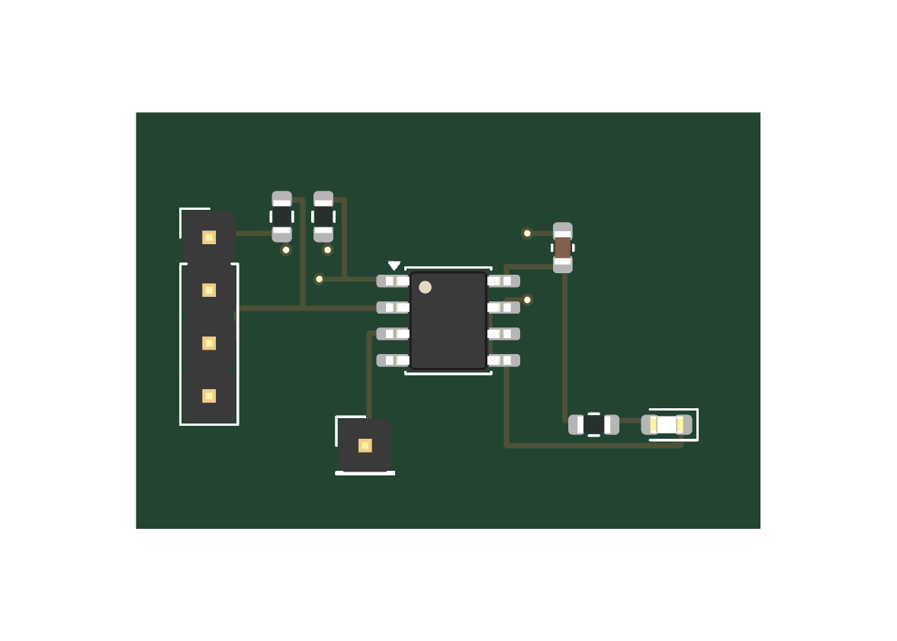

# I2C Temperature Sensor Board

**Job profile: hardware / PCB design engineer**

A 30 x 20 mm two-layer LM75B breakout built entirely from a Python script using the KiCad 10 API: placement, a grid-based maze router (Dijkstra) and fabrication outputs. A KiCad scripting exercise on a small board, not a complex PCB design.



| Ref | Part | Purpose |
|---|---|---|
| U1 | LM75B (SOIC-8), address 0x48 | Temperature sensor |
| C1 | 100 nF | Supply decoupling |
| R1, R2 | 4.7 k | I2C pull-ups |
| R3, D1 | 1 k, LED | Power indicator |
| J1 | 1x4 header | VCC (3.3 V), GND, SCL, SDA |
| J2 | 1x1 header | OS alert output (open drain, needs a pull-up on the host side) |

## Verification
KiCad design rule check: **0 violations, 0 unconnected items** ([report](board/drc_report.txt)), using KiCad's default rules. Gerber and drill files are in `fab/`.

## Build
```bash
"<KiCad>/bin/python.exe" make_board.py
"<KiCad>/bin/kicad-cli.exe" pcb drc --exit-code-violations board/i2c_sensor.kicad_pcb
```

## Limitations
There is no schematic, so no electrical rules check: the netlist is defined in `make_board.py`. Ground is routed as tracks rather than a plane. The board has not been manufactured or tested, and the rules should be matched to the fabricator before ordering.
